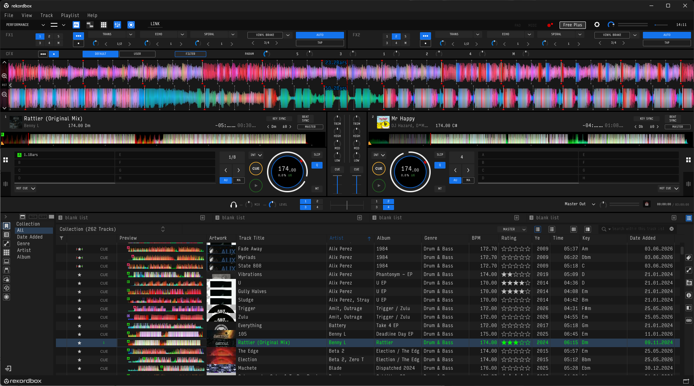

# Custom launcher for rekordbox

A different font, softer colors and a dark title bar for rekordbox on Windows.

The launcher loads a small DLL into rekordbox. It doesn't patch installed files or touch your music or database. Start rekordbox normally to use its original look.

The native title bar uses a dark style by default. Set `DarkTitleBar=0` in `[Window]` to disable it.



## Use

1. Download and extract the Windows x64 ZIP from [Releases](https://github.com/ybelonozhkin/rekordbox-custom-launcher/releases/latest).
2. Close rekordbox, then run `rekordbox-font.exe` from the extracted folder.
3. Edit `font.ini` beside the EXE to change the settings. Restart through the launcher to apply them.

The default font is Segoe UI, included with Windows. You can choose the family name of any installed font:

```ini
[Font]
Family=Segoe UI
```

If the chosen font isn't installed, the launcher falls back to Segoe UI.

Font replacement affects the whole interface. Wider fonts can make BPM values or other fixed-width fields show an ellipsis.

In `[Palette]`, `TintColor` sets an RGB tint (`#RRGGBB`) and `TintStrength` sets its strength from 0 to 100. For example, `TintColor=#C88B55` with `TintStrength=5` adds a subtle warm tint. Set 0 to disable it; 100 fills the processed image with the chosen color.

To replace a color, set `HighlightSourceColor` to the original RGB color, `HighlightColor` to the desired RGB color, and `HighlightStrength` to 0–100. Both colors can be any `#RRGGBB` value. For example:

```ini
HighlightSourceColor=#1473E6
HighlightColor=#B06C42
HighlightStrength=100
```

Set the strength to 0 or leave either color empty to disable replacement. The overall tint is applied afterward.

The palette works on rendered pixels, so it can also affect artwork and waveform images. OpenGL content and native window controls have separate rendering; see [implementation details](docs/technical.md#rendering) for the filter's scope.

Tested with rekordbox **7.2.18 and 7.2.19**, Windows x64. The newest installed version is selected automatically. Future versions may need changes to the hooks. The binaries are unsigned.

```text
rekordbox-font.exe --list
rekordbox-font.exe --exe "D:\rekordbox\rekordbox.exe"
```

## Optional: Input Sans Compressed

Input Sans Compressed is a narrow font available from the author. The official download builder combines the styles below into a four-style family named `Input`.

1. Open the [official Input download page](https://input.djr.com/download/) and choose **Download a custom four-style family**.
2. Select these styles:

| Family slot | Input style |
| --- | --- |
| Regular | Input Sans Compressed Light |
| Italic | Input Sans Compressed Light Italic |
| Bold | Input Sans Compressed Regular |
| Bold Italic | Input Sans Compressed Italic |

3. Use the default character shapes and **1.2×** built-in line spacing. Download and extract the ZIP.
4. Close rekordbox. Select the four `.ttf` files under `Input_Fonts/Input`, right-click and choose **Install** (under **Show more options** on Windows 11).
5. Set the family in `font.ini` and start through the launcher:

```ini
[Font]
Family=Input
```

Regular fills the bold slot for a lighter look. Install one custom Input family at a time: the builder gives them the same internal name, `Input`.

Download Input from the author under its [license](https://input.djr.com/license/). The free license covers development and plain text; non-development use requires a separate license.

## Build

GitHub Actions builds, tests and publishes a release when a version tag is pushed. Each release includes a Windows x64 ZIP, a separate source ZIP and SHA-256 checksums. The source archive includes the build scripts and dependencies.

To build your own copy, follow [BUILDING.md](BUILDING.md). The EXE, DLL and config live in `bin/`; release archives go to `dist/`.

[Settings and implementation](docs/technical.md) · [Changelog](CHANGELOG.md)

MIT. MinHook and its disassembler retain their BSD licenses; see [third-party notices](THIRD_PARTY_NOTICES.md). This is an unofficial project, not affiliated with AlphaTheta.
